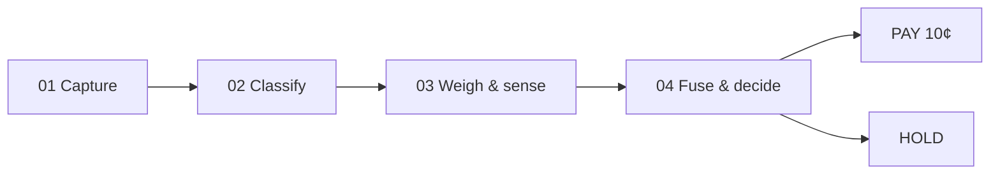

# SmartSort · BCRS Return Verification

**AI vision + sensor fusion for fraud detection in Singapore's Beverage Container Return Scheme (BCRS).**

SmartSort adds a vision-and-sensor check inside the Return Right reverse vending
machine (RVM) chute that confirms an item is genuine **before** the 10¢ refund
is released.

> NTU AI Literacy group project · Group of 6 · AI Exploration Project  
> Credits: **Bui Le Phuong**, **Wong Qi En Joann**, **Wang Zhishan**, **Shi Jiaxiao**,
> **Xu Mengyun**, **Modi Sarthak Ketanbhai**

This repository implements the methodology from the team's final presentation
deck as a well-documented Python package: capture → classify → weigh & sense →
fuse & decide, plus training / export / demo tooling.

**Important:** thresholds are **illustrative / uncalibrated**. No fine-tuned
weights or measured accuracy numbers are shipped. Design targets only — never
fabricated results.

---

## Pipeline



Pseudocode (from the deck):

```text
function evaluate_return(image, weight_g):
    category, cv_conf = classify(image)
    if cv_conf < CONF_MIN:
        return HOLD("low vision confidence")
    if category not in ELIGIBLE_CATEGORIES:
        return HOLD("ineligible: " + category)
    band = WEIGHT_BAND[category]
    if weight_g outside band:
        return HOLD("weight mismatch")
    score = fuse(cv_conf, weight_fit(weight_g, band))
    if score >= ACCEPT_MIN:
        return PAY(0.10)
    return HOLD("fusion score too low")
```

### Classes (aligned with the public trial bay)

| ID | Eligible? |
|----|-----------|
| `pet-bottle` | yes (empty 8–70 g) |
| `aluminium-can` | yes (empty 10–25 g) |
| `rubbish`, `food-waste`, `non-eligible`, `crushed`, `tampered`, `unknown` | no → HOLD |

### Models

| Piece | Default | Notes |
|-------|---------|-------|
| Detector | **YOLOv8n** (`yolov8n.pt`) | Ultralytics; **YOLO11n** (`yolo11n.pt`) is a drop-in alternative |
| Classifier | MobileNetV3-Small (or ResNet50) | Freeze-then-finetune transfer learning |
| OCR / barcode | EasyOCR or pytesseract + pyzbar | Optional imports; graceful fallback |

---

## Trial app alignment

The team's deployed browser trial:

- https://temporary-express-oasis-aafsrpj.vercel.app/trial
- https://temporary-express-oasis-aafsrpj-i6qf2nxpf-anon-omega-green.vercel.app

Class IDs, empty-container weight bands (PET 8–70 g, can 10–25 g), manual weight
entry, and the category-then-verdict flow were read from the live `/trial` UI
(January/November 2026 snapshot via curl). Live vision uses a server-side model
(`zenmux` / `z-ai/glm-4.6v-flash-free` when configured); this Python repo provides
the **offline / trainable** counterpart with mocked or torchvision classifiers.

---

## Quickstart

```bash
python -m venv .venv
source .venv/bin/activate
pip install -r requirements.txt

# Unit tests (mocked classifier — no GPU / weights needed)
pytest -q

# End-to-end demo CLI with synthetic image + mock classifier
python scripts/demo_cli.py --weight-g 18 --category pet-bottle --cv-conf 0.92

# Gradio trial bay
pip install gradio
python app/gradio_app.py
```

### Train / eval / export

```bash
# After you add your own images under data/raw/<class_id>/
python scripts/prepare_dataset.py --src data/raw --dst data/processed
python scripts/train_classifier.py --data data/processed --backbone mobilenet_v3_small

# YOLO detector (default yolov8n.pt; use --weights yolo11n.pt for YOLO11n)
python scripts/train_detector.py --write-template-only
python scripts/train_detector.py --weights yolov8n.pt

python scripts/evaluate.py --cases path/to/cases.json
python scripts/export.py --outdir artifacts/export
python scripts/export.py --export-detector --detector-weights yolov8n.pt
```

---

## Project structure

```text
smartsort-bcrs/
├── README.md
├── LICENSE
├── requirements.txt
├── pyproject.toml
├── smartsort/
│   ├── config.py          # classes, bands, CONF_MIN, ACCEPT_MIN (illustrative)
│   ├── capture.py         # 01 camera / image loading
│   ├── fusion.py          # weight_fit + fuse
│   ├── pipeline.py        # evaluate_return → PAY / HOLD
│   ├── oplog.py           # operator JSONL / CSV log
│   ├── metrics.py         # accuracy / FPR / FNR / latency vs targets
│   ├── models/
│   │   ├── classifier.py  # MobileNetV3 / ResNet50 transfer learning
│   │   ├── detector.py    # YOLOv8n wrapper (YOLO11n drop-in)
│   │   └── ocr.py         # barcode + deposit-mark OCR
│   └── sensors/
│       ├── weight.py      # load cell + manual-entry stub
│       └── material.py    # NIR / capacitive + simulated stub
├── scripts/               # prepare_dataset, train_*, evaluate, export, demo_cli
├── app/                   # Gradio + Streamlit trial bay UIs
├── tests/                 # pytest (pipeline, fusion, weight; mocked CV)
└── docs/
    ├── architecture.md
    ├── methodology.md
    ├── dataset.md
    ├── ethics_and_limitations.md
    ├── results_targets.md
    └── speaker_script_slides_4_5.md
```

---

## Design targets (not measured results)

| Metric | Target |
|--------|--------|
| Vision accuracy | ≥ 95% |
| FPR (fraud paid) | < 2% |
| FNR (valid held) | < 5% |
| Latency | < 2 s |

See `docs/results_targets.md` and `docs/ethics_and_limitations.md`.

---

## License

MIT — see [LICENSE](LICENSE).

BCRS / Return Right / NEA references are for educational context in an NTU coursework prototype and are not an official partnership.
