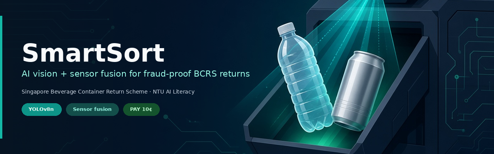
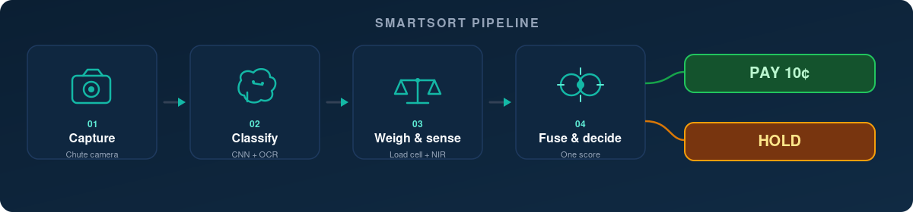
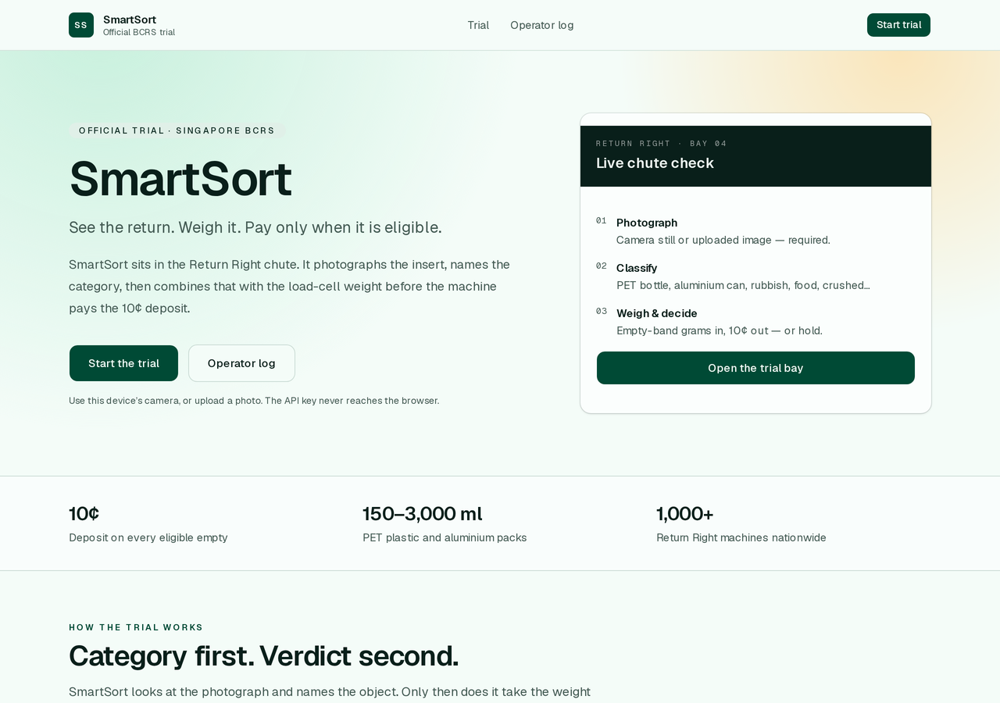
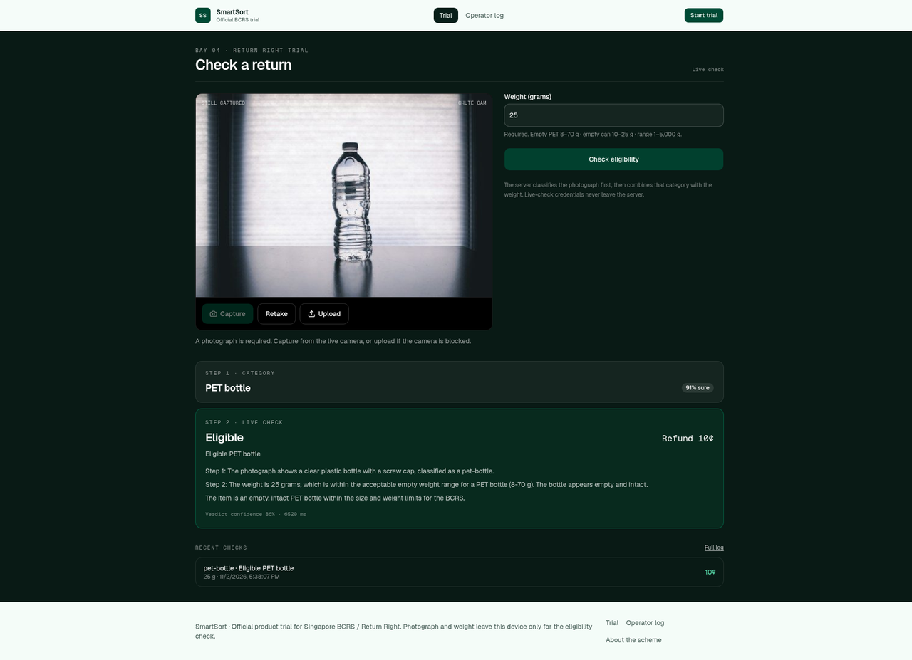
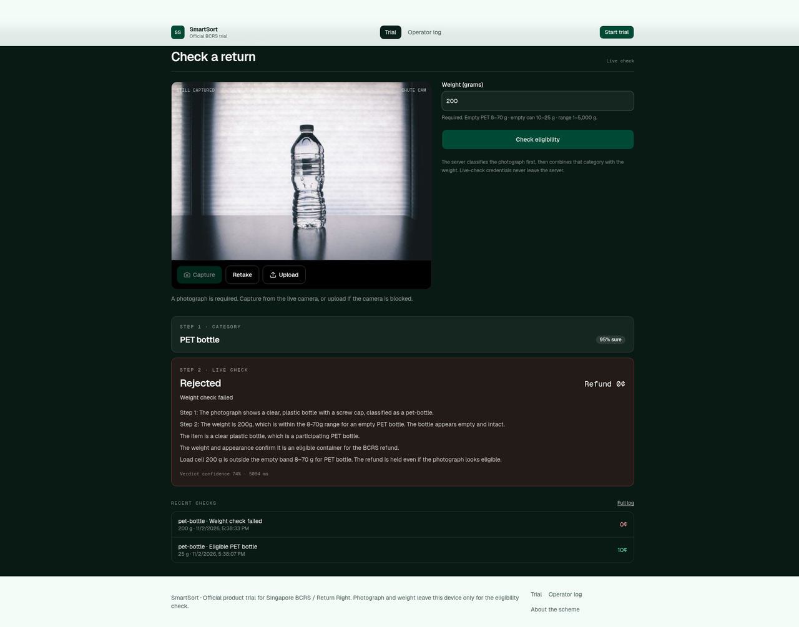
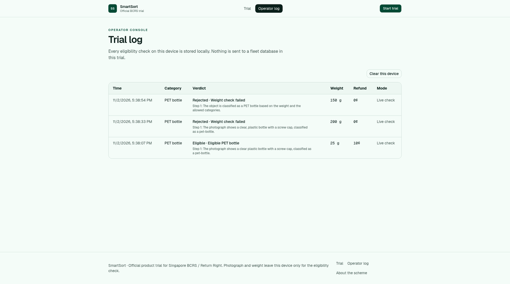
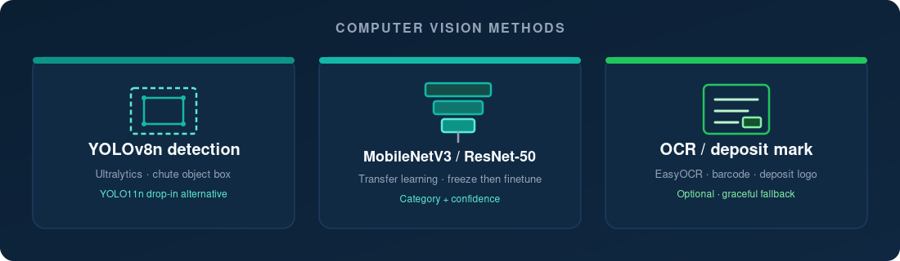
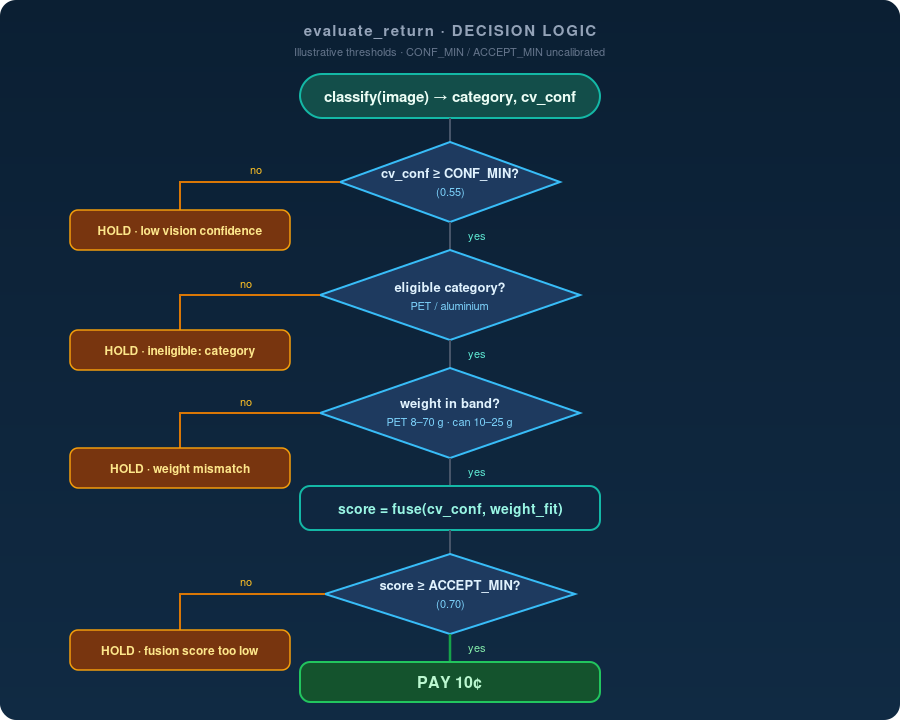
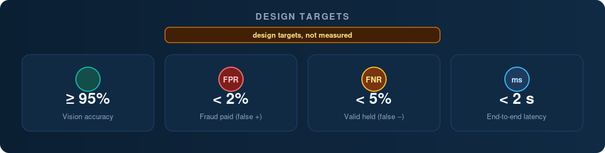

<p align="center">
  
</p>

<p align="center">
  <a href="https://www.python.org/"></a>
  <a href="https://pytorch.org/"></a>
  <a href="https://docs.ultralytics.com/"></a>
  <a href="LICENSE"></a>
  <a href="tests/"></a>
  <a href="https://temporary-express-oasis-aafsrpj.vercel.app/trial"></a>
</p>

<p align="center">
  <a href="https://temporary-express-oasis-aafsrpj.vercel.app/trial"><strong>▶ Try the live demo</strong></a>
  &nbsp;·&nbsp;
  <a href="https://temporary-express-oasis-aafsrpj.vercel.app/trial">Trial bay</a>
  &nbsp;·&nbsp;
  <a href="https://temporary-express-oasis-aafsrpj.vercel.app/log">Operator log</a>
  &nbsp;·&nbsp;
  <a href="https://temporary-express-oasis-aafsrpj.vercel.app">Site root</a>
</p>

**AI vision + sensor fusion for fraud detection in Singapore's Beverage Container Return Scheme (BCRS).**

SmartSort sits inside a Return Right reverse-vending-machine (RVM) chute and
confirms an item is genuine **before** the 10¢ refund is released — photograph,
classify, weigh, fuse, then **PAY** or **HOLD**.

> NTU AI Literacy group project · Group of 6 · AI Exploration Project  
> Credits: **Bui Le Phuong**, **Wong Qi En Joann**, **Wang Zhishan**, **Shi Jiaxiao**,
> **Xu Mengyun**, **Modi Sarthak Ketanbhai**

**Important:** thresholds are **illustrative / uncalibrated**. No fine-tuned
weights or measured accuracy numbers are shipped. Design targets only — never
fabricated results. The **live demo uses a hosted vision-language model as a
stand-in** for on-device vision; this Python repo is the offline / trainable
counterpart.

---

## Pipeline

<p align="center">
  
</p>

| Step | Module | Role |
|------|--------|------|
| 01 Capture | `smartsort/capture.py` | Chute photograph (file, camera, or synthetic) |
| 02 Classify | `smartsort/models/` | YOLO detection + MobileNet/ResNet + OCR |
| 03 Weigh & sense | `smartsort/sensors/` | Load-cell bands + NIR / capacitive |
| 04 Fuse & decide | `fusion.py`, `pipeline.py` | One score → PAY 10¢ or HOLD |

### Classes (aligned with the public trial bay)

| ID | Eligible? |
|----|-----------|
| `pet-bottle` | yes (empty 8–70 g) |
| `aluminium-can` | yes (empty 10–25 g) |
| `rubbish`, `food-waste`, `non-eligible`, `crushed`, `tampered`, `unknown` | no → HOLD |

---

## Live demo gallery

Real screenshots from the hosted trial
([temporary-express-oasis-aafsrpj.vercel.app](https://temporary-express-oasis-aafsrpj.vercel.app)):

| Landing | PAY at 25 g |
|:-------:|:-----------:|
|  |  |
| Site root · Start the trial | PET bottle · 25 g · Eligible · Refund 10¢ |

| HOLD at 200 g | Operator log |
|:-------------:|:------------:|
|  |  |
| PET bottle · 200 g · Weight check failed · 0¢ | Trial log · PAY and HOLD side by side |

<p align="center">
  <a href="https://temporary-express-oasis-aafsrpj.vercel.app/trial"><strong>▶ Open the trial bay</strong></a>
</p>

---

## Computer vision methods

<p align="center">
  
</p>

| Piece | Default | Notes |
|-------|---------|-------|
| Detector | **YOLOv8n** (`yolov8n.pt`) | Ultralytics; **YOLO11n** is a drop-in alternative |
| Classifier | MobileNetV3-Small (or ResNet50) | Freeze-then-finetune transfer learning |
| OCR / barcode | EasyOCR or pytesseract + pyzbar | Optional imports; graceful fallback |

---

## Decision logic

<details>
<summary><strong>evaluate_return flowchart</strong> (CONF_MIN → eligible → weight band → fusion → ACCEPT_MIN)</summary>

<br/>

<p align="center">
  
</p>

```text
function evaluate_return(image, weight_g):
    category, cv_conf = classify(image)
    if cv_conf < CONF_MIN:
        return HOLD("low vision confidence")
    if category not in ELIGIBLE_CATEGORIES:
        return HOLD("ineligible: " + category)
    band = WEIGHT_BAND[category]
    if weight_g outside band:
        return HOLD("weight mismatch")
    score = fuse(cv_conf, weight_fit(weight_g, band))
    if score >= ACCEPT_MIN:
        return PAY(0.10)
    return HOLD("fusion score too low")
```

Thresholds (`CONF_MIN = 0.55`, `ACCEPT_MIN = 0.70`) are **illustrative**.

</details>

---

## Quickstart

```bash
python -m venv .venv
source .venv/bin/activate
pip install -r requirements.txt
pip install -e .   # so `python scripts/...` can import the smartsort package

# Unit tests (mocked classifier — no GPU / weights needed)
pytest -q

# End-to-end demo CLI with synthetic image + mock classifier
python scripts/demo_cli.py --weight-g 18 --category pet-bottle --cv-conf 0.92

# Gradio trial bay
pip install gradio
python app/gradio_app.py
```

### Train / eval / export

```bash
# After you add your own images under data/raw/<class_id>/
python scripts/prepare_dataset.py --src data/raw --dst data/processed
python scripts/train_classifier.py --data data/processed --backbone mobilenet_v3_small

# YOLO detector (default yolov8n.pt; use --weights yolo11n.pt for YOLO11n)
python scripts/train_detector.py --write-template-only
python scripts/train_detector.py --weights yolov8n.pt

python scripts/evaluate.py --cases path/to/cases.json
python scripts/export.py --outdir artifacts/export
python scripts/export.py --export-detector --detector-weights yolov8n.pt
```

---

## Project structure

```text
smartsort-bcrs/
├── README.md
├── LICENSE
├── requirements.txt
├── pyproject.toml
├── smartsort/
│   ├── config.py          # classes, bands, CONF_MIN, ACCEPT_MIN (illustrative)
│   ├── capture.py         # 01 camera / image loading
│   ├── fusion.py          # weight_fit + fuse
│   ├── pipeline.py        # evaluate_return → PAY / HOLD
│   ├── oplog.py           # operator JSONL / CSV log
│   ├── metrics.py         # accuracy / FPR / FNR / latency vs targets
│   ├── models/
│   │   ├── classifier.py  # MobileNetV3 / ResNet50 transfer learning
│   │   ├── detector.py    # YOLOv8n wrapper (YOLO11n drop-in)
│   │   └── ocr.py         # barcode + deposit-mark OCR
│   └── sensors/
│       ├── weight.py      # load cell + manual-entry stub
│       └── material.py    # NIR / capacitive + simulated stub
├── scripts/               # prepare_dataset, train_*, evaluate, export, demo_cli
├── app/                   # Gradio + Streamlit trial bay UIs
├── tests/                 # pytest (pipeline, fusion, weight; mocked CV)
└── docs/
    ├── assets/            # hero, pipeline, CV, decision, targets, demo shots
    ├── architecture.md
    ├── methodology.md
    ├── dataset.md
    ├── ethics_and_limitations.md
    ├── results_targets.md
    └── speaker_script_slides_4_5.md
```

---

## Design targets (not measured results)

<p align="center">
  
</p>

| Metric | Target |
|--------|--------|
| Vision accuracy | ≥ 95% |
| FPR (fraud paid) | < 2% |
| FNR (valid held) | < 5% |
| Latency | < 2 s |

See [`docs/results_targets.md`](docs/results_targets.md) and
[`docs/ethics_and_limitations.md`](docs/ethics_and_limitations.md).

---

## Responsible AI (summary)

- **Bias:** training data must span brands, lighting and wear, or valid returns
  can be wrongly held.
- **Privacy:** camera frames the **chute only** — no bystanders, no facial
  recognition; retain images only as long as the check needs.
- **Human review:** HOLD triggers an operator path, not an unexplained denial.
- **Honesty:** the live trial uses a **hosted VLM stand-in**; this repo ships
  **no trained weights** and **no measured accuracy numbers**.

Full notes: [`docs/ethics_and_limitations.md`](docs/ethics_and_limitations.md).

---

## License

MIT — see [LICENSE](LICENSE).

BCRS / Return Right / NEA references are for educational context in an NTU
coursework prototype and are not an official partnership.
