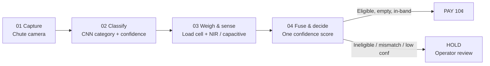

# SmartSort Architecture

SmartSort is an AI vision and sensor system for fraud detection in Singapore's
Beverage Container Return Scheme (BCRS). It sits inside a Return Right reverse
vending machine (RVM) chute and verifies an item **before** the 10¢ refund is
released.

## Four-step pipeline



| Step | Module | Role |
|------|--------|------|
| 01 Capture | `smartsort/capture.py` | Load chute photograph (file, camera, or synthetic) |
| 02 Classify | `smartsort/models/` | YOLO detection + MobileNet/ResNet classification + OCR deposit-mark check |
| 03 Weigh & sense | `smartsort/sensors/` | Load-cell weight bands + NIR/capacitive material |
| 04 Fuse & decide | `smartsort/fusion.py`, `pipeline.py` | `weight_fit` → `fuse` → PAY / HOLD |

## Decision outcomes

- **PAY 10¢** — category ∈ {`pet-bottle`, `aluminium-can`}, vision confidence ≥ `CONF_MIN`, weight inside the empty-container band, fused score ≥ `ACCEPT_MIN`.
- **HOLD** — any failed gate; reasons include `low vision confidence`, `ineligible: <class>`, `weight mismatch`, `fusion score too low`, or material mismatch. Operators review held items (they are not auto-discarded).

## Runtime topology (prototype)

```
Browser / Gradio / CLI  →  evaluate_return(image, weight_g)
                              ├─ MockClassifier or TransferClassifier
                              ├─ ManualWeightEntry (stands in for load cell)
                              ├─ SimulatedMaterialSensor (optional)
                              └─ OperatorLog (JSONL / CSV)
```

The public trial bay (`temporary-express-oasis-aafsrpj.vercel.app/trial`) follows
the same category-then-weight flow. This Python package mirrors that logic for
offline training, evaluation, and edge-export experiments.

## Edge deployment sketch

1. Train classifier / detector offline.
2. Export ONNX (see `scripts/export.py`); TFLite optional.
3. Run inference on low-power RVM hardware with MobileNetV3-Small or **YOLOv8n**
   (`yolov8n.pt`). YOLO11n (`yolo11n.pt`) is a drop-in alternative detector weight.
